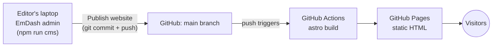

# rustfoundation.org, rebuilt with Astro + EmDash

A prototype of [rustfoundation.org](https://rustfoundation.org) rebuilt as a **static website** with
[Astro](https://astro.build). The content is edited in [EmDash](https://emdashcms.com), a
WordPress-like admin panel, and the site is published to **GitHub Pages**.

- **Live demo:** https://marcoienibot.github.io/rfwebsite/
- **Presentation for the marketing team:** https://marcoienibot.github.io/rfwebsite/presentation/ (source in [`presentation/`](presentation/))
- **How to edit the website:** [docs/EDITING.md](docs/EDITING.md)

## How it works



1. **Editing** happens in the EmDash admin, which runs on the editor's computer
   (`npm run cms`, or double-click **Start editor**). EmDash needs a server and a database,
   which a static host can't provide, so the admin runs locally.
2. **The content lives in git**: [`content/data.db`](content/) (an SQLite database) and
   [`content/media/`](content/media/) (the uploaded images and PDFs).
3. **Publishing**: the **Publish website** button in the admin (a small plugin in
   [`plugins/publish`](plugins/publish/)) commits `content/` and pushes it to `main`. Committing
   and pushing with GitHub Desktop works too.
4. **GitHub Actions** ([`.github/workflows/deploy.yml`](.github/workflows/deploy.yml)) builds the
   site with `output: "static"`. Every page is prerendered from the database to plain HTML, and the
   result is deployed to GitHub Pages. It also rebuilds every night, so scheduled posts go live.

## For developers

```bash
npm install
npm run cms        # editor: pulls, starts EmDash, opens the admin
npm run dev        # just the dev server (admin at http://localhost:4321/_emdash/admin)
npm run build      # static site in dist/client
npm run preview    # serve dist/client
```

Node.js 22.16 or newer is required.

[CI](.github/workflows/ci.yml) runs on every pull request. It checks that `seed/seed.json` matches
`scripts/schema.mjs`, validates the migration page definitions, runs `npm run typecheck`, and builds
the website and the presentation.

| Path | What it is |
| --- | --- |
| `src/pages/` | Routes: home, pages (`[slug]`), news (`media/…`), policies, events, search, RSS |
| `src/components/blocks/` | One Astro component per page block (hero, feature band, logo wall, …) |
| `src/layouts/Base.astro` | Header, mega-menu and footer (driven by the admin's menus) |
| `scripts/schema.mjs` | The content model: collections and block types. It generates `seed/seed.json` |
| `integrations/static-site.mjs` | Static-hosting glue: serves `/media` in dev, copies media and builds the [Pagefind](https://pagefind.app) search index after the build, and rewrites URLs for the `/rfwebsite/` sub-path |
| `plugins/publish/` | EmDash plugin that adds the **Publish website** button and deploy status |
| `scripts/wordpress/` | One-off migration from the WordPress site (posts, policies, pages, people, organisations, events, documents, FAQs, media) |
| `presentation/` | [Slidev](https://sli.dev) deck explaining the new workflow |

### Changing the content model

Edit `scripts/schema.mjs` and run `node scripts/schema.mjs`. A fresh database picks up the new
`seed/seed.json`. On the existing database, make the same change in the admin (Content types),
or apply the seed with `npx emdash seed seed/seed.json --database content/data.db --on-conflict update`.

Removing a field or a select option from a block type is a breaking change, so add a new version of
the block in `scripts/schema.mjs` (see the comment above `block()`) and keep the old versions.
Blocks already stored stay on their version until you migrate them: update each entry through the
content API with `migrateBlocks: true`, keeping each block's `_key` and changing its `_version` and
fields to the new version's.

### Re-running the WordPress migration

```bash
scripts/wordpress/migrate.sh   # replaces content/ with a fresh import of rustfoundation.org
```

To re-apply only the page definitions in `scripts/wordpress/pages/` (and event data) to the
existing content, keeping everything edited in the admin, run
`node scripts/wordpress/update-content.mjs .cache/wordpress [page-slug…]` while `npm run dev` is running.
After a fix to the converter or the scraper, `--posts post-slug…` converts the named posts and
policies again (it replaces their content), and `--people` updates biographies and profile links
(biographies edited in the admin are left alone).

### Custom domain

Configure the domain in the repository's GitHub Pages settings. The workflow reads the site URL from
GitHub Pages, and URLs are only rewritten when the site lives under a sub-path, so on
`https://rustfoundation.org` nothing changes.
