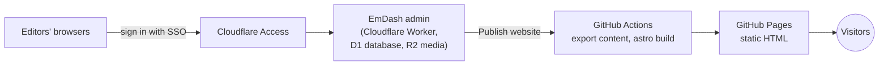

# Proposal: a shared editor on Cloudflare, a static website on GitHub Pages

**Status:** proposal. Nothing on this page is implemented yet.

This page describes a way to give several editors one shared EmDash admin while the public website
stays a static site on GitHub Pages, as it is today.

## Why change anything

The current setup (see the [README](../README.md#how-it-works)) works well for one editor. With
several people publishing regularly, it has limits:

- **Two editors can't publish independently.** The content is an SQLite file in git, and git can't
  merge two versions of it. If two people edit between pulls, the second one to publish sees
  *"Someone else published at the same time"* and a developer has to combine the changes by hand.
- **Every editor needs a developer setup**: Node.js, a clone of the repository, and push access to
  `main`. That access lets them push code, not only content, so EmDash's roles (Contributor,
  Author, Editor) don't restrict anything.
- **Nobody else can see a draft.** It stays on one laptop until it is published, and there is no
  preview link to send to a reviewer.
- **The repository grows with every publish**, because each one commits a new copy of the database.

Running all of EmDash on Cloudflare would fix these, but the public website would become a running
application that renders pages on request. This option keeps the public site static.

## How it would work

1. **The admin runs on Cloudflare.** The same code is deployed as a Cloudflare Worker at its own
   address (for example `cms.rustfoundation.org`), using a D1 database for content and an R2 bucket
   for media. The whole address is behind [Cloudflare Access], and EmDash uses Access as its only
   way to sign in (`auth: access()` from `@emdash-cms/cloudflare`). Nobody can reach the admin, or
   even its sign-in page, without passing your identity provider. EmDash creates an account on
   first sign-in and can map identity-provider groups to EmDash roles.
2. **Content no longer lives in git.** `content/data.db` and `content/media/` are replaced by D1
   and R2. Editors only need a browser and an account in the identity provider. Only developers need
   access to the repository.
3. **The public website is built as it is today.** Before `npm run build`, the deploy workflow:
   - exports the D1 database with `wrangler d1 export` and loads it into `content/data.db` with
     `sqlite3`;
   - copies the R2 bucket into `content/media/` (for example with `aws s3 sync`, leaving out
     EmDash's `backups/` folder).

   From there the build doesn't change: every page is prerendered, Pagefind indexes it, and the
   result is deployed to GitHub Pages.
4. **"Publish website" starts a build.** Editors still publish entries in the admin, then click
   **Publish website**. The publish plugin no longer runs git: it starts the deploy workflow through
   GitHub's `workflow_dispatch` API and shows its progress, as it does now. The workflow keeps its
   nightly run, and a run every 15 minutes or so would also publish scheduled posts without anyone
   clicking.

## Pros

- **The public website stays static.** It is as fast and as free to host as it is now, and it has
  nothing to attack. If Cloudflare or the admin is down, the website stays up. Only editing stops.
- **The admin isn't reachable from the internet.** Access turns requests away before they reach
  EmDash. There are no passwords or passkeys to manage, and adding or removing an editor happens in
  the identity provider.
- **Editors can work at the same time.** There is one shared database: no merge conflicts, edit
  locks on each entry, revision history, and everyone sees everyone's drafts.
- **Preview links work.** A draft can be sent to a reviewer, who opens it on the Worker after
  signing in through Access.
- **Content access is separate from code access.** Editors no longer need push access to `main`,
  and EmDash's roles become meaningful: a Contributor can write drafts that an Editor publishes.
- **Editors need no setup**: no Node.js, git, repository clone or **Start editor**.
- **The repository stops growing** with every publish, and media is no longer stored in git.
- **It should cost nothing.** Only editors use the Worker, which fits the Workers Free plan, and
  Cloudflare's Zero Trust Free plan covers Access for up to 50 users. The publish plugin is a native
  plugin, so it doesn't need the paid plan that sandboxed plugins require.

## Cons

- **More moving parts.** There is a Cloudflare account, a Worker, D1, R2 and an Access application
  to look after, two build targets from one code base, and Cloudflare credentials stored as GitHub
  secrets. Someone has to own this.
- **We write and maintain the glue ourselves.** The export has a known pitfall: a plain
  `wrangler d1 export` fails because EmDash keeps its search index in FTS5 virtual tables, so the
  tables have to be exported by name ([EmDash backup guide][d1-dump]). An EmDash upgrade could
  change the schema and break the export.
- **Publishing still takes a couple of minutes**, as it does now. Scheduled posts go live at the
  next build after their time, not at the exact minute.
- **Content history leaves git.** There is no `git log` or `git revert` for content any more.
  History lives in EmDash revisions, and recovery relies on D1 Time Travel, which reaches back 7
  days on the Workers Free plan and 30 days on the Paid plan. Longer retention needs our own
  backups, kept somewhere private: the export contains editors' email addresses, so it must not be a
  workflow artifact of a public repository.
- **Developers no longer have the content locally.** Working with real content means running the
  same export with Cloudflare credentials.
- **What editors preview isn't exactly what visitors get.** The Worker renders pages on request
  from the latest content, while the website shows the last build, so the two differ until the next
  build. Pagefind search doesn't work in the preview.
- **The admin depends on Cloudflare.** Moving the admin elsewhere later means migrating D1 and R2
  (EmDash's site export makes that possible). The public website doesn't depend on Cloudflare.
- **An Access outage or a misconfigured policy locks editors out.** The website keeps working.

## Compared with the alternatives

| | Today | This proposal | Everything on Cloudflare |
| --- | --- | --- | --- |
| Public website | Static, GitHub Pages | Static, GitHub Pages | Rendered by a Worker, cached at the edge |
| Editors need | Node.js, git, push access to `main` | A browser and an SSO account | A browser and an SSO account |
| Editing at the same time | Conflicts need a developer | Safe | Safe |
| Admin reachable from the internet | No (runs locally) | No (behind Access) | Yes, unless Access protects `/_emdash/*` |
| Time to publish | A few minutes | A few minutes | Seconds |
| Scheduled posts | At the nightly build | At the next build | At the scheduled minute |
| Content history | git | EmDash revisions, D1 Time Travel | EmDash revisions, D1 Time Travel |
| Moving parts to own | GitHub only | GitHub, Cloudflare, export glue | Cloudflare, runtime operations |

## Work needed

1. **Worker build.** Add `@astrojs/cloudflare`, `wrangler.jsonc` (D1, R2 and a Cron Trigger for
   EmDash's scheduler) and a Worker entry point, and select `d1()`, `r2()` and `access()` instead of
   `sqlite()` and `local()` when building for Cloudflare. `integrations/static-site.mjs` already
   switches every route to on-demand rendering in `astro dev`, and the Worker build needs the same.
2. **Media URLs.** The static build serves media from `/media/<storageKey>`. On the Worker,
   `mediaSrc()` and `publicMediaUrl()` in `src/utils/media.ts` should return EmDash's media route
   instead, because `/media/` is also where news posts live (`src/pages/media/[slug].astro`).
3. **Access.** Create an Access application for the Worker's whole address (EmDash requires at
   least `/_emdash/*`) and store its audience tag with `wrangler secret put CF_ACCESS_AUDIENCE`.
4. **Migration.** Move the current content into the Worker once, preferably with a site package
   (`emdash site export` from a local copy, then `emdash site import` into the Worker). A raw SQL
   dump can't always be imported into D1, which rejects statements of 100 KB or more.
5. **Deploy workflow.** Add the D1 export and the R2 copy before `npm run build`, and a
   `workflow_dispatch` trigger plus a more frequent schedule.
6. **Publish plugin.** Replace the git commit and push with a `workflow_dispatch` call, using a
   fine-grained GitHub token limited to **Actions: write** on this repository, stored as a Worker
   secret. Keep the deploy status display.
7. **Clean-up.** Remove `content/` from the repository, `scripts/cms.mjs` and the **Start editor**
   launchers, and rewrite [EDITING.md](EDITING.md) for the hosted admin.

## Open questions

- Which identity provider should Access use? Google Workspace, a GitHub organisation, or one-time
  codes sent by email.
- Should builds run only when someone clicks **Publish website**, or also on a schedule, and how
  often?
- Where should backups beyond D1 Time Travel's window be kept?

[Cloudflare Access]: https://docs.emdashcms.com/guides/authentication/#cloudflare-access
[d1-dump]: https://docs.emdashcms.com/guides/backups/#create-an-offsite-d1-dump
