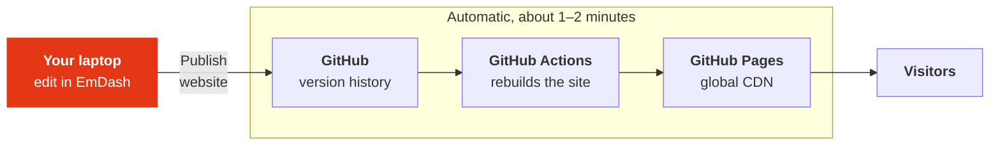

A proposal for the marketing team

# A simpler, safer rustfoundation.org

How we could edit and publish the website without WordPress

Marco Ieni · Rust Foundation

<!--
Hi everyone, thanks for making time.

Today I want to show you a different way to run rustfoundation.org. I'll show you what editing and publishing look like day to day, and I'll be upfront about the downsides too.

Nothing is decided yet. I want your feedback, because you're the people who use the website every day.

Plan for the session: about 20 minutes of slides, then a live demo, then questions. Feel free to interrupt at any time.
-->

---
layout: statement
class: rf-dark
title: The short version
---

# Same friendly admin. Same content. A faster, safer, free website.

That's the whole pitch. The rest of this talk shows how it works, and what it costs us in convenience.

<!--
If you only remember one slide, it's this one.

- You still get an admin that looks and feels a lot like WordPress.
- All our existing content has already been moved over.
- The website itself gets faster, much harder to attack, and it costs nothing to host.

There are trade-offs, and I'll be honest about them. The biggest one: you edit from your laptop instead of from any browser. I'll get to that.
-->

---

# Why look at something new?

Common issues with WordPress websites in general. This isn't a criticism of how our site has been run.

  

    <ph-plugs class="tile-icon" />
    <h3>The plugin treadmill</h3>
    
Every plugin needs regular updates, and any update can break a page or clash with another plugin.

  

  

    <ph-shield-warning class="tile-icon" />
    <h3>Security patches</h3>
    
WordPress is so popular that it's a favourite target for attackers. Login pages and plugins are the usual way in.

  

  

    <ph-stack class="tile-icon" />
    <h3>Page-builder bloat</h3>
    
Page builders add a lot of extra code to every page, which makes pages heavier and slower to load.

  

  

    <ph-currency-dollar class="tile-icon" />
    <h3>Ongoing cost</h3>
    
Managed WordPress hosting is a recurring bill, and many popular plugins are paid subscriptions.

  

Our site today: WordPress on WP Engine, built with the Beaver Builder page builder, plus plugins including The Events Calendar, SEOPress, Gravity Forms, WP Rocket and Font Awesome.

<!--
Before talking about the new setup, here's why it's worth looking at all.

These are general WordPress issues, not a judgement on our site. WordPress is great at many things, but a typical WordPress site:

- depends on a stack of plugins that all need updating, and updates sometimes break things;
- is a constant target for attackers, simply because WordPress is everywhere;
- often uses a page builder like Beaver Builder, which is flexible but adds a lot of extra code to every page;
- costs money every month for hosting and plugin licences.

Our site has exactly this shape: WP Engine hosting, Beaver Builder, and plugins for events, SEO, forms, caching and icons. Every one of those is something that needs updating and could break.
-->

---

# What stays the same

  

    <ph-browser class="tile-icon" />
    <h3>A friendly admin</h3>
    
Pages, posts, media library, menus, categories and tags, SEO fields, drafts, previews, revision history and scheduled publishing. If you know WordPress, you'll feel at home.

  

  

    <ph-files class="tile-icon" />
    <h3>All of our content</h3>
    
Posts, pages, policies and the media library have already been moved over automatically from the current site. Nothing needs retyping.

  

  

    <ph-paint-brush class="tile-icon" />
    <h3>The Rust Foundation look</h3>
    
Same brand, same content, same kind of pages. Visitors get the website they know, just faster.

  

What changes is <strong>where the editor runs</strong> and <strong>how changes go live</strong>. That's what most of this talk is about.

<!--
Let me start with what doesn't change, because that's what matters most for your day-to-day work.

1. You still log into an admin that looks a lot like WordPress: pages, posts, media, menus, categories, SEO fields, drafts, previews, revision history, scheduling.
2. All our content has already been migrated automatically. I'll show the numbers later.
3. The site keeps the Rust Foundation brand and content.

What changes is the plumbing: where the editor runs, and what happens when you click publish.
-->

---

# Words you'll hear today

| Word | In plain English |
|---|---|
| **Static website** | Pages are built once, ahead of time, and handed out as they are. Like printing a brochure instead of writing it again for every reader. |
| **Astro** | The tool that turns our content and design into those ready-made pages. |
| **EmDash** | The admin where you edit content. Think of it as "the new WordPress admin". |
| **Git** | The version history of the website: every change, who made it and when. |
| **GitHub** | Where that history is stored online, and where we manage who has access. |
| **GitHub Actions** | A robot that rebuilds the website automatically every time someone publishes. |
| **GitHub Pages** | GitHub's free web hosting. It serves the site from a CDN (servers worldwide), so it's fast everywhere. |
| **GitHub Desktop** | A friendly app to see the history of the website, and to undo changes. |

<!--
A quick glossary, so the rest of the talk makes sense. You don't need to memorise this; I'll explain things again as they come up.

The key idea is "static website". Today, WordPress builds every page on the fly when someone visits. In the new setup, pages are built once, when we publish, and then simply handed out. It's the difference between printing a brochure once and writing it by hand for every reader.

Everything with "GitHub" in the name is a free service we already use at the Rust Foundation for code. Here we use it to store the website's history, rebuild it, and host it.
-->

---

# The new setup in one picture

  

    <h3>You only touch the orange box</h3>
    
Edit and save in the admin as usual, then click <strong>Publish website</strong>.

  

  

    <h3>Everything after that is automatic</h3>
    
The admin shows the progress, from "Building…" to "The website is live".

  

<!--
Here's the whole system in one picture.

1. You edit in EmDash, which runs on your laptop.
2. When you're happy, you click "Publish website". That saves your changes into the version history and sends them to GitHub.
3. GitHub Actions, the robot, notices the change and rebuilds the whole website.
4. GitHub Pages puts the new version live, served from servers all over the world.
5. Visitors see the update, about 1 to 2 minutes after you clicked.

The important part for you: you only ever deal with the first box. Everything else is automatic, and the admin tells you when it's done.
-->

---

# The website: today and tomorrow

  

    
    
Today: WordPress on WP Engine

  

  

    
    
New: static site, demo at <a href="https://marcoienibot.github.io/rfwebsite/" target="_blank">marcoienibot.github.io/rfwebsite</a>

  

<!--
On the left is the current homepage, on the right is the new one, built from the migrated content.

The demo is live right now at marcoienibot.github.io/rfwebsite. Feel free to click around after the meeting and tell me anything that looks wrong or missing; that kind of feedback is really valuable.

(Point out a couple of sections that look the same, and anything that's deliberately different.)
-->

---

# Getting started: once, then one double-click

  

    <ph-wrench class="tile-icon" />
    <h3>One-time setup (we do it together)</h3>
    <ol>
      <li>Install <strong>Node.js</strong>, the engine the editor runs on</li>
      <li>Install <strong>GitHub Desktop</strong></li>
      <li>Get access to the website's GitHub repository (the project folder plus its history)</li>
      <li>Download ("clone") it to your laptop and sign in to GitHub once, so the Publish button can upload</li>
    </ol>
  

  

    <ph-cursor-click class="tile-icon" />
    <h3>Every time you want to edit</h3>
    <ol>
      <li>Double-click <strong>Start editor</strong> (or run <code>npm run cms</code>)</li>
      <li>It downloads the latest version of the website</li>
      <li>The admin opens in your browser. No password: it only runs on your laptop.</li>
      <li>Keep that window open while you edit</li>
    </ol>
  

The editor runs on <strong>your laptop</strong>. Visitors never see it; they only ever see the published website.

<!--
This is the biggest change compared to WordPress, so I want to be very clear about it.

The editor doesn't live on a server somewhere. It runs on your own laptop.

There's a one-time setup per person: install two free apps, Node.js and GitHub Desktop, get access to the project on GitHub, and download it. I'll sit with each of you and do this together; it's a one-off.

After that, editing is: double-click "Start editor". It fetches the latest version of the website, starts the editor and opens the admin in your browser. There's no password because it only runs on your machine.

Nothing you do in the editor is public until you click Publish.
-->

---

# The dashboard

- Opens automatically after **Start editor**
- Pages, posts ("News & blog"), policies, media, menus, categories and tags
- Lists that feed the whole site: **Organisations** (members and partners, with their logos), **People**, **Events**, **Documents** (reports, board minutes) and **FAQs**
- The **Website** box tells you if you have changes that aren't on the public site yet, and has the **Publish website** button

  

<!--
This is the first thing you see after Start editor: the EmDash dashboard.

On the left there's the menu you'd expect: pages, news and blog posts, policies, media, menus, categories and tags.

There are also a few lists that didn't exist as such in WordPress: Organisations, People, Events, Documents and FAQs. Add a new Silver member once, with its logo, and it shows up on the members page and the home page automatically. Same for a new staff member on the About page, a new event, or a new set of board minutes.

The box I want you to notice is the "Website" one. We added it for this setup. It tells you if you have saved changes that aren't on the public website yet, and it has the Publish website button right there.
-->

---

# Pages are built from blocks

- A page is a stack of ready-made blocks: page header, cards, logo wall, people grid, stats, FAQ, call-to-action, video, rich text and more
- Add, reorder and edit blocks **without code**
- The design is built into the blocks, so pages stay on-brand
- Preview before publishing; revision history if you change your mind

  

<!--
Pages work a bit like Beaver Builder, but simpler.

A page is a stack of blocks: a page header, some cards, a logo wall of members, a people grid, a FAQ, a call-to-action, and so on. You add blocks, drag them into order, and fill in the text and images.

The difference from a page builder: you don't fiddle with spacing, fonts or colours. The design lives inside the blocks, so every page looks consistent and on-brand.

If we need a new kind of block, that's a developer task, and a small one.
-->

---

# Writing a news post

- A familiar rich-text editor
- Categories (Blog, News, Press) and tags
- SEO title and description per post
- Save as draft, preview, schedule (goes live with the nightly rebuild)
- Revision history for every post

  

<!--
Writing a news or blog post is the bit you'll do most often, and it should feel very familiar.

Title, a rich-text editor for the body, a featured image, categories and tags, and the SEO fields that SEOPress gives you today.

Drafts, previews and revision history all work like you'd expect.

Scheduling works too, with one nuance: the website rebuilds itself every night, so a scheduled post goes live at the first nightly rebuild after its date (or straight away, if someone publishes in the meantime).

One thing to remember: an edited post is a draft until you click "Publish changes" on it. The Publish website screen lists any entries that still have unpublished edits, so nothing gets forgotten.
-->

---

# The media library

- All images and documents the site uses were migrated (~425 files)
- Images were converted to a modern format: about 11 MB instead of the original ~200 MB
- Upload once, reuse in any page or post
- Images are saved in the website's version history too, so nothing gets lost

  

<!--
The media library, again very WordPress-like.

All the images and files the site actually uses came across in the migration, about 425 of them, including the PDFs (annual reports, board minutes). The images were also converted to a modern format, which makes them much smaller and the site faster.

One nice detail: images are stored together with the content in the version history. So if someone deletes or replaces an image by mistake, we can get the old one back.
-->

---

# Optional: an AI assistant that can help

  

    <ph-robot class="tile-icon" />
    <h3>Built in</h3>
    
EmDash has a built-in MCP server: a standard way for AI assistants to use an app. It works with Claude, ChatGPT / Codex and Cursor.

  

  

    <ph-user-circle class="tile-icon" />
    <h3>Same rules as a person</h3>
    
The assistant gets the same permissions as a team member. It edits your local copy, and nothing goes live until you click Publish website.

  

  

    <ph-lightbulb class="tile-icon" />
    <h3>Ideas</h3>
    <ul>
      <li>"Turn these notes into a draft news post"</li>
      <li>"Find every page that mentions the old program name"</li>
      <li>"Suggest SEO descriptions for these posts"</li>
    </ul>
  

<!--
This is a bonus, not a requirement.

EmDash comes with something called an MCP server, which is a standard way for AI assistants like Claude, ChatGPT or Cursor to work with an app. It means you can ask an assistant to do content chores for you.

It has the same permissions as a team member, and because everything happens on your laptop first, you always review the result before you publish.

Nobody has to use this. It's there if it saves you time.
-->

---

# Publishing: one button

1. **Save** and **Publish** entries as usual. So far they're only on your laptop.
2. Open **Publish website** and, if you like, say what you changed: "Added the October board update"
3. Click **Publish website**
4. Watch the status: "Waiting to start…" → "Building…" → **"The website is live"**, in about 1–2 minutes

  

<!--
Now the important part: getting changes live.

Saving works as usual, but saved changes only exist on your laptop at first. Think of it as a draft of the whole website.

When you're ready, go to Publish website. You can type a short note about what you changed; that note ends up in the history, which is handy later. Then click the button.

The screen then shows the progress: waiting, building, and finally "The website is live". That usually takes a minute or two. There's also a link to open the live website.

You can publish one change or twenty at once; it's the same button.
-->

---

# What happens behind the button

- Your changes are saved into the **version history** and sent to **GitHub**
- **GitHub Actions** rebuilds the whole website from scratch
- **GitHub Pages** puts the new version live worldwide
- If a build ever fails, the current website **simply stays as it was**, and the admin tells you to ask a developer

  

<!--
You never need to look at this screen, but I want to show you what happens behind the scenes, so it doesn't feel like magic.

When you click publish, the robot, GitHub Actions, picks up your changes, rebuilds every page of the site, and hands the result to GitHub Pages. This is the page you'd see if you clicked the "details" link in the admin.

The reassuring bit: if anything goes wrong during the build, nothing gets published. The current website stays online exactly as it was. You'd see a message in the admin saying the last deployment failed, and you'd ping me.
-->

---

# Every change is recorded, and can be undone

- Every publish is saved in the history: **who**, **when**, **what changed**, plus your note
- See it on **github.com** (screenshot) or in **GitHub Desktop**
- Undo a change: in GitHub Desktop, right-click it → **Revert Changes in Commit** → **Push**
- Restore the whole website to any earlier version: an "undo" for the entire site
- GitHub Desktop is also a second way to publish: **Commit** → **Push**

  

<!--
This is one of my favourite parts.

Every time anyone publishes, it's recorded in the history: who did it, when, which pages and images changed, and the note they wrote.

You can browse that history on github.com (that's what's on screen) or in GitHub Desktop. If a change was a mistake, you can revert it there and push, and the site goes back. We can also restore the entire website to how it looked on any earlier date.

To be precise: undoing the most recent publish is a couple of clicks. Going further back restores the whole site to that point, so any later changes would need to be redone. For that, just ask me.

GitHub Desktop is also a backup way to publish: Commit, then Push. If the admin ever says "Saved, but not uploaded", that's what you'd do.
-->

---

# WordPress on WP Engine vs the new setup

| | WordPress on WP Engine (today) | New setup |
|---|---|---|
| Editing experience | WordPress admin + Beaver Builder | EmDash admin: pages from blocks, posts, media. Feels like WordPress |
| Where you can edit from | Any browser, anywhere | Your laptop, after a one-time setup |
| Two people editing at once | Yes | One at a time; agree who edits when |
| Publish speed | Instant | About 1–2 minutes |
| Hosting cost | WP Engine subscription | Free (GitHub Pages) |
| Security | Live server, login page, plugins to keep patched | No live database, no login page, nothing to patch on the server |
| Page speed | Pages built on every visit, sped up by a cache plugin | Pre-built pages from a global CDN |
| History and rollback | Revisions per page or post | Revisions, plus a history of the whole site with rollback |
| Search and events | Plugins (WordPress search, The Events Calendar) | Built in: site search, and an Events list in the admin |
| Forms | Gravity Forms installed, but none in use | Not needed today; a form service if we ever need one |
| Analytics, cookie banner | Google Analytics + SEOPress banner | Not added yet: one snippet |
| Add-ons | Huge plugin ecosystem | Young, smaller ecosystem |

<!--
Here's everything side by side. I've tried to make this fair, so there are rows where WordPress clearly wins.

WordPress wins on: editing from anywhere, several people editing at once, instant publishing, and the size of the plugin ecosystem.

Search and events are already covered in the new setup. Forms turned out not to be an issue: the current site doesn't actually use any (contact is by email and the training application is a Typeform link). Analytics and the cookie banner still need to be added, which is a small job.

The new setup wins on: cost, security, speed and history.

So the question for us is: are the advantages on the right worth the convenience we give up on the left? The next slides go through both sides.
-->

---

# What we gain

  

    <ph-lightning class="tile-icon" />
    <h3>Very fast pages</h3>
    
Pre-built pages, served from servers around the world.

  

  

    <ph-shield-check class="tile-icon" />
    <h3>Much more secure</h3>
    
No live database, no login page, no plugins to hack, nothing to patch on the server.

  

  

    <ph-piggy-bank class="tile-icon" />
    <h3>Free hosting</h3>
    
GitHub Pages costs nothing. No WP Engine bill.

  

  

    <ph-trend-up class="tile-icon" />
    <h3>Handles traffic spikes</h3>
    
A big announcement can't take the site down.

  

  

    <ph-clock-counter-clockwise class="tile-icon" />
    <h3>Full history</h3>
    
Who changed what, and when, with rollback for the whole site.

  

  

    <ph-key class="tile-icon" />
    <h3>Our content, our repo</h3>
    
Everything lives in our own repository. No vendor lock-in.

  

  

    <ph-heart class="tile-icon" />
    <h3>A stack developers enjoy</h3>
    
Modern tools make it easier to get help and to improve the site.

  

  

    <ph-sparkle class="tile-icon" />
    <h3>AI-assisted editing</h3>
    
Optional help from Claude, ChatGPT or Cursor.

  

<!--
The upsides, in one place.

- Speed: pages are ready-made and served from a worldwide network, so they load fast for everyone.
- Security: there's no live server running WordPress, no database, no login page. There is simply much less that can be attacked, and nothing for anyone to patch.
- Cost: hosting is free.
- Reliability: a big announcement or a traffic spike can't take the site down.
- History: every change is recorded and can be undone.
- Ownership: the content lives in our own repository. If we ever want to move away from EmDash or GitHub, we take everything with us.
- Developers like working with this stack, which makes it easier to get help, including from volunteers.
- And optionally, AI assistance.
-->

---

# The honest trade-offs: day to day

| The catch | What we do about it |
|---|---|
| **One-time setup** on each editor's laptop | We do it together, once per person. After that it's a double-click. |
| You edit **from your laptop**, not from any browser or phone | Fine for planned work. If it becomes a blocker, we move the editor online (see "upgrade path"). |
| **Two people publishing at the same time can clash** (all content lives in a single file) | Agree who edits when, e.g. a quick "I'm editing the site" message. Always start the editor fresh: it downloads the latest version. The admin warns you if someone else has published. |
| Publishing takes **1–2 minutes**, not instant | Preview before publishing. The admin shows the progress and tells you when the site is live. |
| Logins on your laptop use a **shared "editor" account** | The version history records who published what, and when. |

<!--
Now the downsides. I'd rather you hear them from me now than discover them later.

1. Setup. Each editor needs a one-time setup. I'll do it with you.
2. Laptop only. You can't fix a typo from your phone on the train. For planned work this is fine; if it turns out to be a real problem, there's an upgrade path, which I'll show in a moment.
3. Conflicts. This is the important one. All the content lives in one database file, so if two people edit and publish at the same time, the second one gets a conflict and needs a developer to merge things. The fix is a habit: say when you're editing, and always start the editor fresh. Start editor downloads the latest version automatically, and the admin warns you if someone else published in the meantime.
4. Publishing takes a minute or two instead of being instant.
5. On your laptop everyone appears as the same "editor" user inside the admin. Who did what is tracked in the version history instead, through each person's GitHub account.
-->

---

# The honest trade-offs: features and maturity

| The catch | What we do about it |
|---|---|
| **Things that need a server** (forms, search, calendars) | Search is built in (it runs in the visitor's browser). Events are a list in the admin. The site has no forms today; a form service (Tally, Formspree, HubSpot) covers that if needed |
| **Analytics and the cookie banner** aren't there yet | Add one snippet: Google Analytics like today, or a cookie-free tool such as Plausible (then no banner is needed) |
| **Large files in the history**: every publish stores a new copy of the content database (~13 MB) | Fine for years of normal use; a developer can clean the history up if it ever gets big |
| **EmDash is young** (version 1.x, 2026), with a much smaller plugin ecosystem than WordPress | Open source (MIT) and made by Cloudflare. The site itself is standard Astro, and our content lives in our own repository, so we're never locked in |

<!--
The second group of trade-offs is about features.

A static website can't run code on a server when a visitor clicks something. For us that turns out to matter less than you'd think:

- Search: done. It's built when the site is published and runs in the visitor's browser. Try /search on the demo.
- Events: done. Events are a list in the admin, like members and people, and the events page and event pages are generated from it.
- Forms: the current site doesn't actually use any. Contact is by email, and the training application is a Typeform link, which keeps working.
- Analytics and the cookie banner still need adding. That's a small job, and if we pick a cookie-free analytics tool we don't even need the banner.

Two honest caveats: every publish stores a new copy of the content database in the history, which is fine for a long time but means the project folder grows; and EmDash is new, with a small ecosystem. It's open source, from Cloudflare, the site is plain Astro and the content is ours, so the risk is limited.
-->

---

# If the laptop setup turns out to be a blocker

  

    <ph-laptop class="tile-icon" />
    <h3>Start: the editor on your laptop</h3>
    <ul>
      <li>Free, nothing to run or maintain</li>
      <li>One-time setup per person</li>
      <li>One person publishes at a time</li>
    </ul>
  

  

    <ph-globe class="tile-icon" />
    <h3>Upgrade: the editor online</h3>
    <ul>
      <li>Host the EmDash admin on a small server, e.g. Cloudflare's free tier</li>
      <li>Everyone edits in the browser, from anywhere, at the same time</li>
      <li>Real accounts for each person</li>
    </ul>
  

The site design and content stay <strong>exactly the same</strong>, and the public website can stay static. It's a step up, not a rebuild.

<!--
The laptop setup is the simplest, cheapest way to start. But if it turns out to be painful, we're not stuck.

We can host the EmDash admin online on a small server, for example on Cloudflare's free tier. Then everyone edits from any browser, from anywhere, at the same time, each with their own account. That's very close to the WordPress experience you have today.

And the design and content stay exactly the same, and the public website can stay static and free. So we're not betting everything on the laptop approach; it's step one.
-->

---

# Migration status: all content is already in

  

    
310

    
posts

    
Blog, News and Press, with authors, categories, tags and original dates. The 51 press items link to the external articles.

  

  

    
25

    
pages

    
Rebuilt from blocks, editable in the admin

  

  

    
273

    
list entries

    
16 policies, 72 organisations, 28 people, 29 events, 82 documents, 46 FAQs

  

  

    
~425

    
media files

    
Images and PDFs the site uses

  

Old URLs keep working (same addresses, plus redirects for moved pages). <strong>Still open:</strong> analytics and cookie banner, a review by the marketing team, and switching the domain.

<!--
Where are we today?

All of the content has been migrated automatically from the current site: 310 posts across Blog, News and Press with their original dates, authors, categories and tags; 25 pages rebuilt from blocks (the other two WordPress "pages" were just redirects); and 273 entries in the new lists: policies, organisations, people, events, documents and FAQs. Around 425 images and PDFs came along.

Addresses stay the same, so links from search engines and other sites keep working, and old addresses that moved have redirects.

What's still open: analytics and the cookie banner, a proper review by you, the people who know the content best, and eventually pointing rustfoundation.org at the new site.
-->

---

# Live demo

<ol class="checklist">
  <li>Open the live site: <a href="https://marcoienibot.github.io/rfwebsite/" target="_blank">marcoienibot.github.io/rfwebsite</a></li>
  <li>Double-click <strong>Start editor</strong></li>
  <li>Change the homepage headline, then <strong>Save</strong> and <strong>Publish changes</strong></li>
  <li>Add a news post with an image</li>
  <li>Open <strong>Publish website</strong> and click the button</li>
  <li>Watch it build: "Building…" → "The website is live"</li>
  <li>Refresh the live site: there's the change</li>
  <li>Show the change in GitHub Desktop's history, and how to undo it</li>
</ol>

<!--
Time for the live demo. (Switch to the browser.)

Before the meeting: make sure GitHub Desktop is open, the editor is NOT already running, and the live site is open in a tab.

1. Show the live site.
2. Double-click Start editor; point out that it downloads the latest version first.
3. Change the homepage headline, save.
4. Create a news post, add an image from the media library, save.
5. Go to Publish website, type a note, click the button.
6. While it builds (1–2 minutes), show the GitHub Actions run via the "details" link. Good moment to take a question.
7. Refresh the live site and show both changes.
8. Open the history (github.com or GitHub Desktop), show the new entry with my note, and show how "Revert Changes in Commit" in GitHub Desktop would undo it.

Remember to revert the demo changes afterwards.
-->

---

# What I'm asking for

  

    <ph-flag class="tile-icon" />
    <h3>1. A 2–4 week pilot</h3>
    
One or two editors use the new setup for real work. The WordPress site stays live meanwhile, and we compare.

  

  

    <ph-list-checks class="tile-icon" />
    <h3>2. Analytics and review</h3>
    
Choose analytics (Google Analytics like today, or a cookie-free tool) and review the rebuilt pages.

  

  

    <ph-signpost class="tile-icon" />
    <h3>3. Laptop or online editor?</h3>
    
After the pilot, decide whether the laptop editor is good enough or we host the editor online.

  

<strong>From you today:</strong> volunteers for the pilot, and a list of what you do in WordPress every week, so we can check it's all covered.

<!--
So here's what I'm proposing.

1. A pilot of 2 to 4 weeks with one or two of you, doing real work in the new setup. During the pilot nothing changes for the public: the WordPress site stays live, and we compare the two.
2. In parallel, we pick an analytics tool, and you review the rebuilt pages and tell me what's missing or wrong.
3. At the end of the pilot, we decide together whether the laptop editor is good enough, or whether we host the editor online.

Only after that would we talk about actually switching rustfoundation.org over.

What I need from you today: a volunteer or two, and a list of the things you do in WordPress every week, so I can make sure nothing is missing.
-->

---
layout: center
class: rf-dark text-center
---

# Questions?

  
Demo site: <a href="https://marcoienibot.github.io/rfwebsite/" target="_blank">marcoienibot.github.io/rfwebsite</a>

  
These slides: <a href="https://marcoienibot.github.io/rfwebsite/presentation/" target="_blank">marcoienibot.github.io/rfwebsite/presentation</a>

  
Repository: <a href="https://github.com/marcoienibot/rfwebsite" target="_blank">github.com/marcoienibot/rfwebsite</a>

  
EmDash: <a href="https://emdashcms.com" target="_blank">emdashcms.com</a>

<!--
That's it from me. Questions, worries, "but what about..." are all welcome; the trade-offs are exactly what I want to hear about.

The links are on screen, and these slides stay online, so you can go back to them later.

Thanks!
-->
